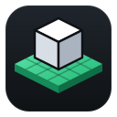

# Baseplate

A dark studio for Pop!_OS where each of your Roblox systems (inventory, shop,
quests…) lives as its own project: scripts, GUIs and notes. Design GUIs in Figma,
preview them, ask the AI assistant for help, and live-sync everything into
Roblox Studio with Rojo.

Baseplate was called Roblox Vault. Your systems are copied over on first start,
and the app offers to remove the old version.



## Install

```bash
flatpak install --user https://jayswansocool48.github.io/baseplate/baseplate.flatpakref
```

Then open **Baseplate** from the app launcher. The icon stays in your
Applications like any other app.

## Update

Updates show up in the **COSMIC Store** under Updates, next to your other apps.
From a terminal: `flatpak update`.

## Uninstall

In the app: **Menu → Uninstall Baseplate…**. It removes the app, its icon
and all of its data, including Roblox Vault and the older zip version. You can also
uninstall it from the COSMIC Store, or run:

```bash
flatpak uninstall --user --delete-data io.github.jayswansocool48.Baseplate
```

## Sync with Roblox Studio

Rojo is built into the app.

1. Install **Vinegar** from the COSMIC Store to run Roblox Studio on Linux.
2. In Studio, get the **Rojo** plugin from the Creator Store.
3. In Baseplate, pick a system and press **Sync** (Ctrl+R). In Studio:
   **Plugins → Rojo → Connect**. Every save now shows up in Studio.

Don't want live sync? **Build** (Ctrl+B) writes a `.rbxl` place file you can open in Studio.

## AI assistant

Press **Assistant** (Ctrl+J) to open the chat on the right. Pick who answers in
**Assistant settings** (the gear):

| Assistant | Cost | Your code goes to |
|---|---|---|
| **Ollama** | Free | Nowhere; it runs on your computer. Install from [ollama.com](https://ollama.com), then `ollama pull qwen2.5-coder` |
| **Claude** | Pay per use on your Anthropic API account | Anthropic |
| **ChatGPT** | Pay per use on your OpenAI API account | OpenAI |

A Claude.ai or ChatGPT Plus subscription doesn't include API use; get an API key
from the link in settings. Keys are stored only on your computer.

Under **Share** you choose what the assistant sees: the open file, and/or the
system's file names and notes. Code in replies has buttons to **Apply to file**
(Ctrl+Z undoes it), **Insert** at the cursor, save as a **New script…**, or
**Copy**. The assistant follows your naming rules: no `V2`, `_New` or `_Final`
names.

## The three tabs

- **Code**: edit scripts, GUI files and notes.
- **Preview**: see the open GUI on a pretend Roblox screen. Switch screen size
  (desktop, laptop, tablet, phone), hover to inspect elements, click buttons to
  test them. It updates live as you type, and after Figma imports.
- **Figma**: figma.com inside the app.

## Using Figma

1. Open the **Figma** tab and press **Open Figma**. Sign in with your Figma email
   and password. Google sign-in usually refuses to work inside apps.
2. **Connect once.** Press **Connect Figma**. A bar explains the steps: in Figma
   click your name → Settings → Security → Generate new token (*File content:
   read-only*) → **Copy**. The app grabs it automatically; there's nothing to paste.
   Tokens expire (Figma's maximum is 90 days); when one does, the app asks you to connect again.
3. Open a design file, **click a frame**, press **Import selected frame**
   (Ctrl+I). It becomes a GUI named after the frame and opens in Preview. No
   frame selected? You get a list of the file's frames to pick from. If another
   GUI already has that name, the app asks for a new one (it never makes
   `Inventory2`-style copies).
4. Change the design, then press **Update from Figma** (Ctrl+Shift+R). With Rojo
   sync on, Studio updates too.

**Figma's limits.** Each import or update uses Figma API requests, and Figma caps
them: free and View/Collab seats can get as few as **20 a month**; paid Full/Dev
seats get 10 or more a minute. So the app never checks Figma automatically.
Selecting the frame before importing saves a request, and Update fetches all GUIs
from the same file in one request.

| Figma | Roblox |
|---|---|
| Frame / group / rectangle | Frame |
| Text | TextLabel (size, colour, alignment) |
| Layer named `Button…` / `…Btn` | TextButton |
| Corner radius / ellipse | UICorner |
| Stroke | UIStroke |
| Image fill | ImageLabel (upload the image to Roblox, paste its asset ID) |
| Layer order | ZIndex |

**Limits.** Fonts use Roblox's default. Vectors and icons arrive as plain boxes;
export them as images. An update overwrites edits made to that GUI in the app.
Changes only flow from Figma to Roblox: Figma's API can't write designs back.

## How projects are laid out

| Folder in the app | Lands in Roblox as |
|---|---|
| `server/` (Script) | ServerScriptService.Server |
| `client/` (LocalScript) | StarterPlayerScripts.Client |
| `shared/` (ModuleScript) | ReplicatedStorage.Shared |
| `gui/` (ScreenGui `.model.json`) | StarterGui |

Each project also has `notes.md` for writing down what the system does and how
it connects to your other systems. **Menu → Open project folder** shows the files.

**Names.** Names with version or status tags (`InventorySystemV3`,
`PlayerMovement_New`, `Weapon_Final`) are refused. Keep one clean name per
system and change it in place.

## Sound effects

Short sounds play for saves, imports, sync, deletes and errors. Turn them off with
**Menu → Sound effects**. They're made from scratch by `tools/make_sounds.py`.

## Developing

```bash
python3 -m unittest discover -t . -s tests   # tests
python3 -m baseplate                      # run from source (needs the GTK packages)
./packaging/build.sh                         # build and install the Flatpak locally
```

### Publishing (one time)

```bash
./packaging/publish-setup.sh
```

This creates the GitHub repo with your `github-kit` (public, so GitHub Pages can
host the app), lists it in your apps catalog, makes the update-signing key, turns
on GitHub Pages, builds the app and installs it.

### Releasing an update

```bash
./packaging/release.sh 1.1.0 "What changed"
```

Every push to `main` is tested, built and published by
`.github/workflows/flatpak.yml`. The COSMIC Store then offers the update.

## Legal

Privacy policy, terms and the other policies are in `baseplate/legal/` and inside
the app (Menu → Legal & privacy). See [COMPLIANCE.md](COMPLIANCE.md) for the
20-item checklist. MIT License.

Not affiliated with or endorsed by Roblox Corporation or Figma, Inc.
